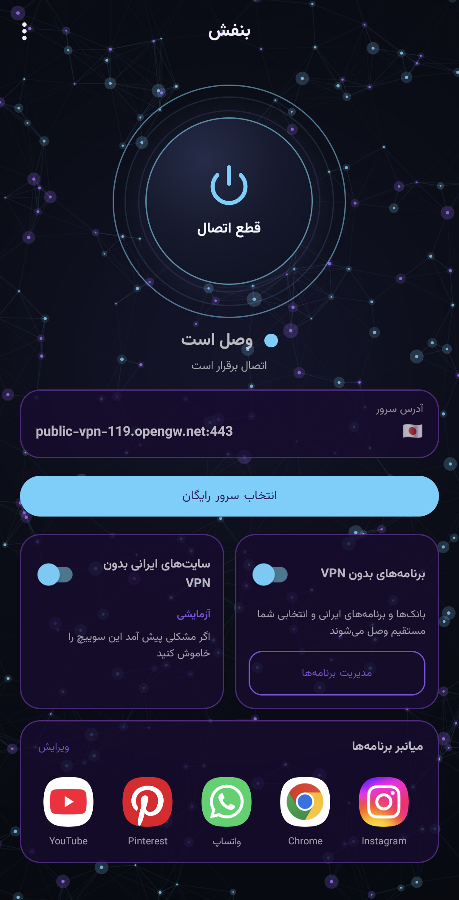
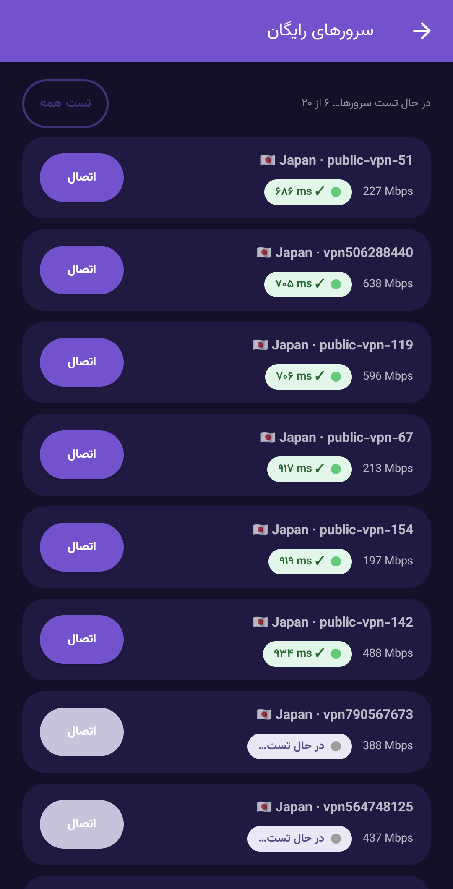
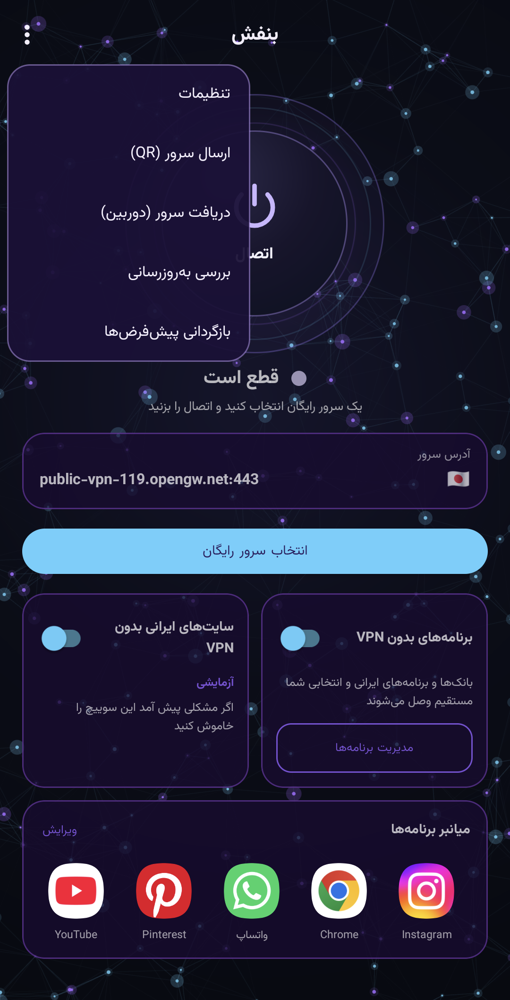
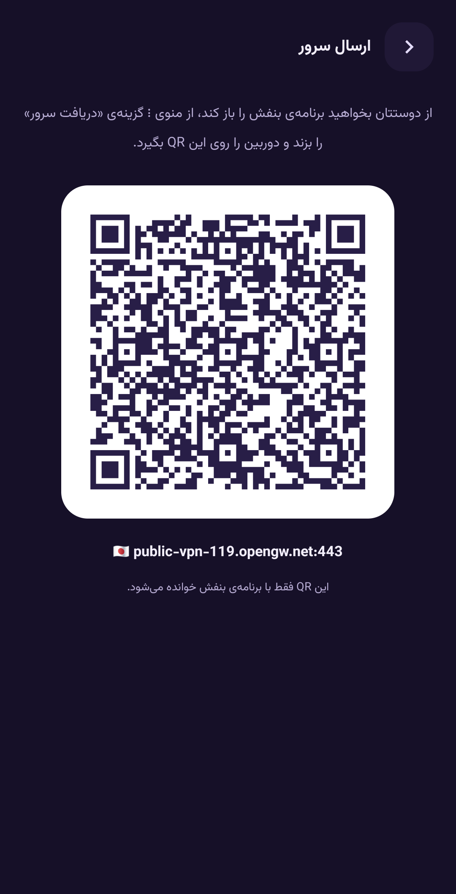
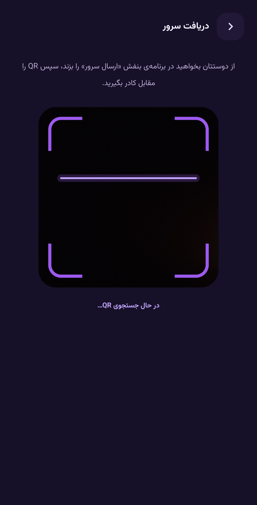
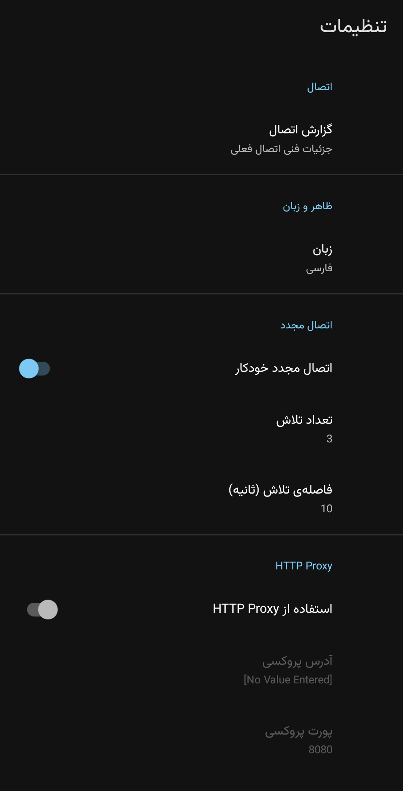

# بنفش (Banafsh)

فارسی | **[English](README.md)**

یک برنامه‌ی ساده و رایگان SSTP VPN برای اندروید، مخصوص کاربران عادی. یک سرور رایگان از لیست انتخاب کنید، دکمه‌ی **اتصال** را بزنید، تمام.

کانال تلگرام: https://t.me/Banafsh_sstp

## امکانات

- یک دکمه‌ی بزرگ اتصال و لیست سرورهای رایگان (VPN Gate) با تست خودکار، چراغ وضعیت، سرعت و پرچم کشور
- **برنامه‌های بدون VPN**: بانک‌ها و برنامه‌های ایرانی مستقیم وصل می‌شوند و برنامه‌های دلخواه را هم با جست‌وجو می‌توانید اضافه کنید
- **سایت‌های ایرانی بدون VPN** (آزمایشی): سایت‌های ایرانی مستقیم باز می‌شوند
- ارسال سرور فعلی برای دوستان با QR و دریافت آن با دوربین
- اتصال مجدد خودکار، آپدیت درون‌برنامه‌ای و اعلان خبر کوتاه
- تم تاریک، فارسی و انگلیسی

## تصاویر

  
  
  

  
  
  

## نصب

۱. آخرین APK را از صفحه‌ی [Releases](https://github.com/Banafshex/Banafsh-sstp/releases) دانلود کنید.
۲. بازش کنید و نصب کنید. چون برنامه روی گوگل‌پلی نیست، Google Play Protect ممکن است هشدار بدهد؛ گزینه‌ی **Install anyway** را بزنید.

## نکته‌ی مهم

سرورهای رایگان را داوطلب‌ها (VPN Gate) راه‌اندازی کرده‌اند و ممکن است لاگ اتصال نگه دارند. با این VPN وارد حساب‌های حساس مثل بانک نشوید. بانک ایرانی با IP غیرایرانی اصلاً باز نمی‌شود و برای همین گزینه‌ی «برنامه‌های بدون VPN» وجود دارد.

## سازنده‌ی اصلی و لایسنس

بنفش فورکی از [Open SSTP Client](https://github.com/kittoku/Open-SSTP-Client) ساخته‌ی kittoku است و با لایسنس MIT منتشر می‌شود. سرورهای رایگان از [VPN Gate](https://www.vpngate.net/) (دانشگاه تسوکوبا) می‌آیند.

ساخته‌شده توسط BANAFSHX.

