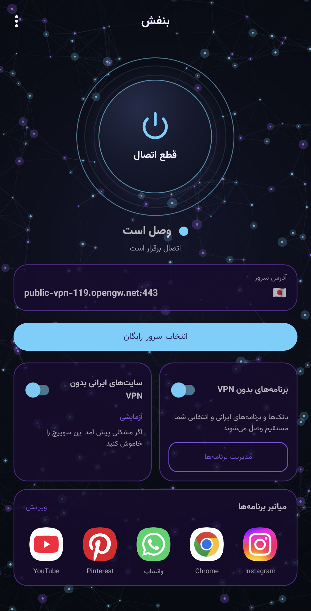
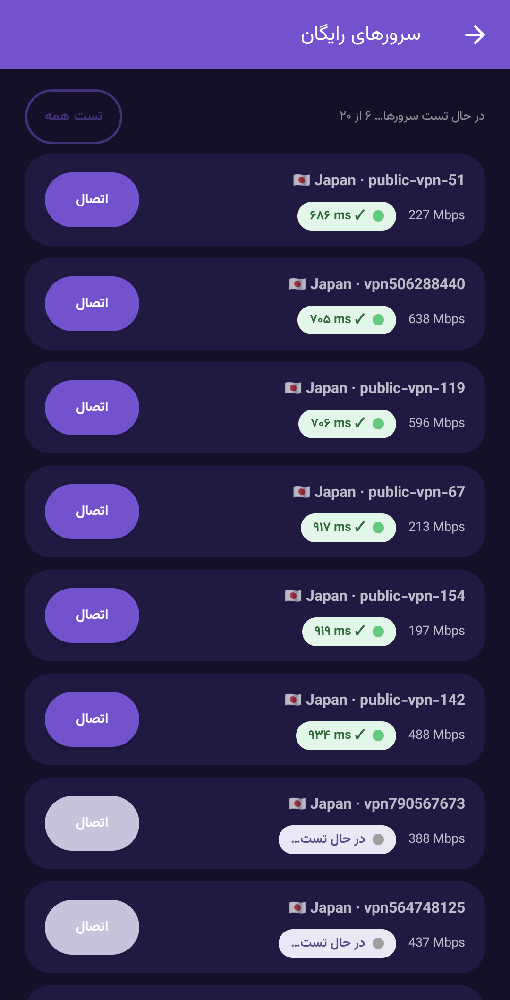
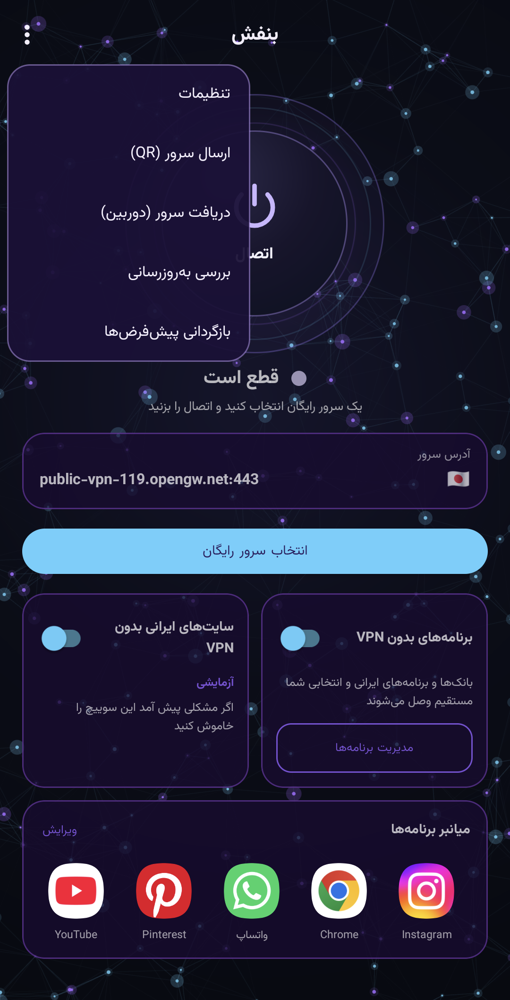
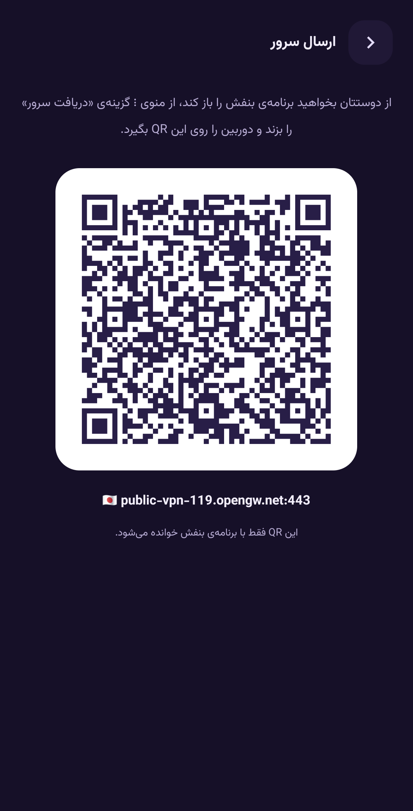
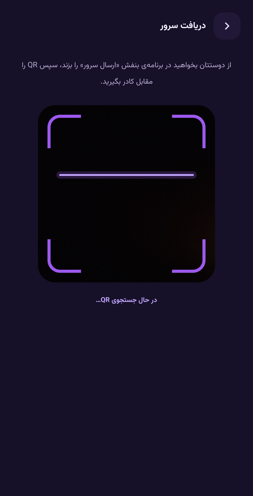
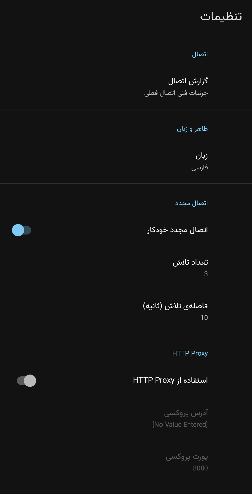

# Banafsh (بنفش)

**[فارسی](README.fa.md)** | English

A simple, free SSTP VPN app for Android, made for everyday users. Pick a free server from the list, tap **Connect**, done.

Telegram channel: https://t.me/Banafsh_sstp

## Features

- One big Connect button and a free servers list (VPN Gate), with automatic testing, status lights, speed and country flags
- **Apps without VPN**: Iranian banks and apps connect directly; add your own apps with search
- **Iranian sites without VPN** (experimental): Iranian sites open directly
- Share the current server with a friend using a QR code, and receive one with the camera
- Automatic reconnect, in-app updates and short news notices
- Dark theme, Persian and English

## Screenshots

  
  
  

  
  
  

## Install

1. Download the latest APK from the [Releases](https://github.com/Banafshex/Banafsh-sstp/releases) page.
2. Open it and install. Google Play Protect may show a warning because the app is not on Google Play; tap **Install anyway**.

## Please note

The free servers are run by volunteers (VPN Gate) and they may keep connection logs. Do not log in to sensitive accounts such as banks through this VPN. Iranian banks do not open with a non-Iranian IP anyway, which is why the "Apps without VPN" option exists.

## Credits and license

Banafsh is a fork of [Open SSTP Client](https://github.com/kittoku/Open-SSTP-Client) by kittoku, released under the MIT license. Free servers come from [VPN Gate](https://www.vpngate.net/) (University of Tsukuba).

Made by BANAFSHX.
