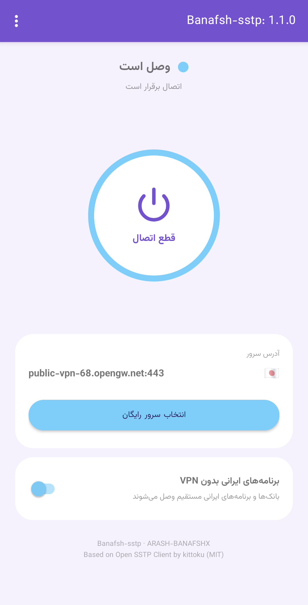
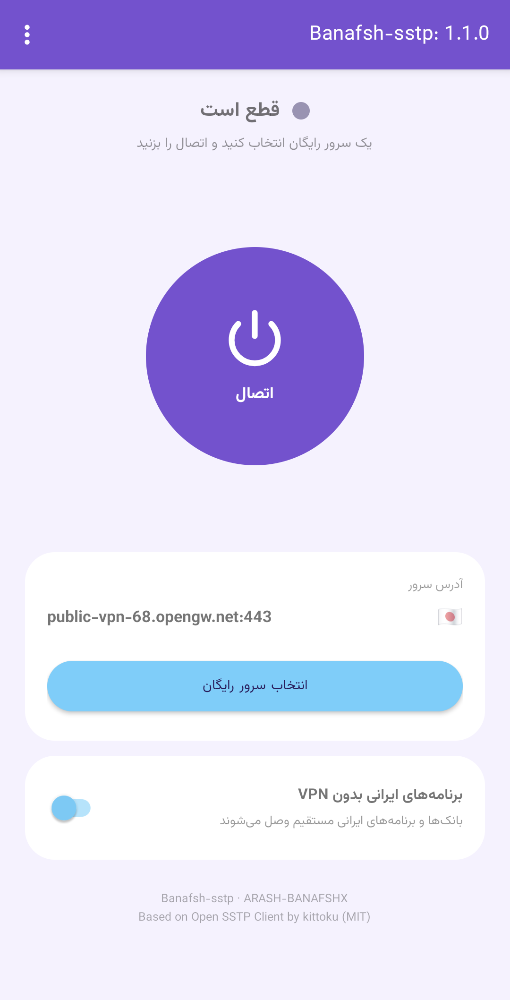
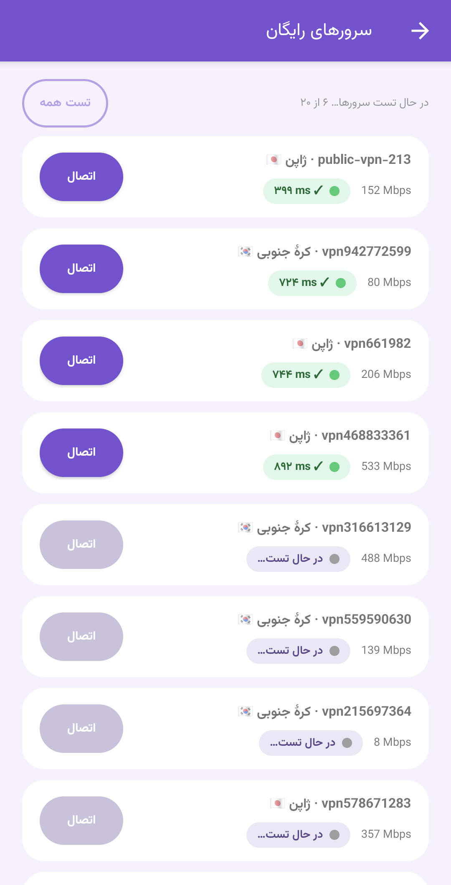
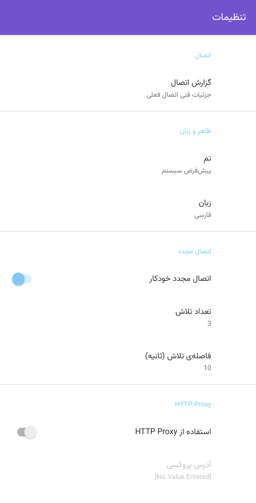

# Banafsh-sstp

**یک برنامه‌ی ساده و فارسی‌زبان برای اندروید، برای اتصال به سرورهای رایگان SSTP از VPN Gate**

[English](README.md) | فارسی

  
  
  
  

## این برنامه چیه؟

Banafsh-sstp برای کاربرهای عادی ساخته شده، نه متخصص‌های شبکه. یه سرور رایگان انتخاب می‌کنی، روی **اتصال** می‌زنی و تمام. نه حساب کاربری لازمه، نه فایل کانفیگ، نه دانش فنی.

این برنامه فورکی از [Open SSTP Client](https://github.com/kittoku/Open-SSTP-Client) ساخته‌ی kittoku است که با ظاهر ساده‌تر و امکانات بیشتر بازطراحی شده.

## امکانات

- **اتصال با یک لمس**: دکمه‌ی بزرگ اتصال / قطع اتصال روی صفحه‌ی اصلی.
- **لیست سرورهای رایگان**: سرورهای VPN Gate که خودکار به‌روز می‌شن، با پرچم کشور کنار هر کدوم.
- **تست خودکار سرورها**: پینگ و پهنای باند هر سرور نشون داده می‌شه. سرورهای سالم اول لیست‌ان و سرورهای ناسالم کم‌رنگ و آخر لیست.
- **برنامه‌های ایرانی بدون VPN**: بانک‌ها و برنامه‌های ایرانی حتی وقتی VPN وصله مستقیم وصل می‌شن. لیست این برنامه‌ها خودکار به‌روز می‌شه.
- **اتصال مجدد خودکار**: اگه اتصال قطع بشه، دوباره برقرار می‌شه.
- **اشتراک‌گذاری با QR**: سرور فعلی‌ت رو برای دوستت بفرست تا داخل خود برنامه اسکنش کنه. این QR با دوربین معمولی قابل خوندن نیست.
- **آپدیت و خبر درون‌برنامه‌ای**: نسخه‌ی جدید هر روز چک می‌شه و از داخل برنامه نصب می‌شه.
- **فارسی و انگلیسی**: پیش‌فرض زبان سیستمه و جهت صفحه خودکار تنظیم می‌شه.
- **اعلان وضعیت**: مرحله‌ی اتصال (در حال اتصال / دریافت IP / وصل) و IP رو نشون می‌ده، با دکمه‌ی قطع اتصال.
- **تنظیمات پیشرفته** برای کاربرهای حرفه‌ای، که به‌طور پیش‌فرض جمع‌شده‌ان تا مبتدی‌ها شلوغی نبینن.

## نصب

1. وارد صفحه‌ی [Releases](../../releases) بشو و آخرین فایل `.apk` رو دانلود کن.
2. فایل رو روی گوشی باز کن. اگه اندروید پرسید، اجازه‌ی نصب از این منبع رو بده.
3. اگه **Play Protect** هشدار داد، روی **Install anyway** بزن. این هشدار به این خاطره که برنامه توی گوگل پلی منتشر نشده.

حداقل نسخه‌ی اندروید: ۸.۰

## طرز استفاده

1. روی **انتخاب سرور رایگان** بزن و یکی از سرورهای دارای چراغ سبز (سالم و سریع) رو انتخاب کن.
2. روی **اتصال** بزن.
3. اگه می‌خوای بانک‌ها و برنامه‌های ایرانی مستقیم کار کنن، کلید **برنامه‌های ایرانی بدون VPN** رو روشن نگه دار.

اگه سروری وصل نشد، یکی دیگه رو امتحان کن. سرورهای رایگان رو داوطلب‌ها راه انداختن و ممکنه بیان و برن.

## حریم خصوصی و ایمنی

سرورها رو داوطلب‌های سراسر دنیا راه‌اندازی کرده‌ن. سرورهای داوطلب ممکنه لاگ اتصال رو حداقل دو هفته نگه دارن و خود VPN Gate لاگ اتصال رو حداقل سه ماه نگه می‌داره.

- با این سرویس برای کارهای حساس مثل لاگین به بانک **استفاده نکن**.
- بانک‌های ایرانی با IP غیرایرانی اصلاً باز نمی‌شن.
- استفاده از برنامه با مسئولیت خودته.

## ساخت از روی سورس

ساخت برنامه با GitHub Actions انجام می‌شه:

- با هر push یک نسخه‌ی debug ساخته می‌شه که از تب **Actions** قابل دانلوده.
- ورک‌فلوی **Release APK** نسخه‌ی امضاشده می‌سازه و به سه Secret گیتهاب برای کلید امضا (keystore، alias و رمزها) نیاز داره.

برای ساخت روی کامپیوتر، پروژه رو توی Android Studio باز کن و تسک `assembleDebug` رو اجرا کن.

## سازنده‌ها و لایسنس

- پروژه‌ی اصلی: [Open SSTP Client](https://github.com/kittoku/Open-SSTP-Client) از **kittoku** (MIT)
- Banafsh-sstp از **BANAFSHX**
- سرورهای رایگان: [VPN Gate](https://www.vpngate.net/)، دانشگاه تسوکوبا، ژاپن
- فونت: [Vazirmatn](https://github.com/rastikerdar/vazirmatn)

تحت لایسنس [MIT](LICENSE) منتشر شده. خبرها و آپدیت‌ها رو توی تلگرام دنبال کن: [@Banafsh_sstp](https://t.me/Banafsh_sstp)

